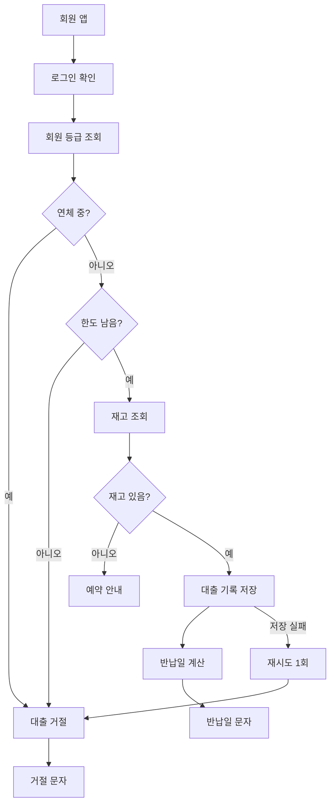
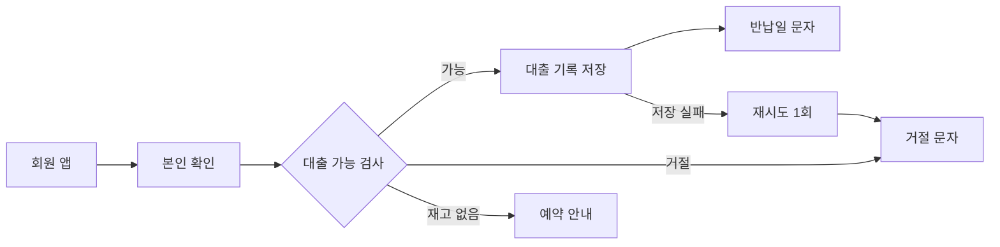
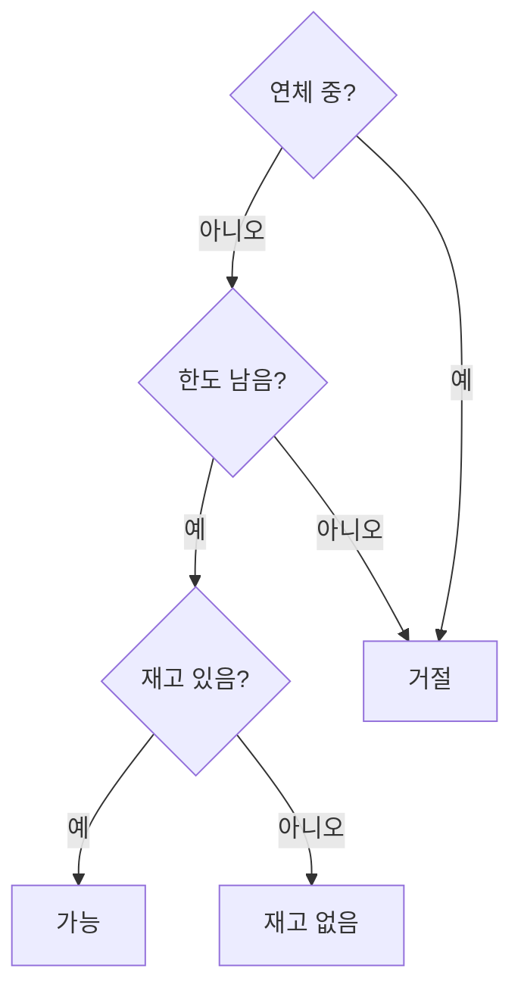

# Before / after — 실패 모드별 16쌍

같은 사실, 다른 문장. 왼쪽은 에이전트가 기본으로 쓰는 것, 오른쪽은 이 스킬을 지킨 것.
규칙 번호는 `SKILL.md`.

## 1. 단편 불릿 → 온전한 문장 (규칙 4)

**Before**
```
- A · 시간축 · render+send 스킵
- B · 이벤트 기반 · diff만
- 메모리 ↓, 지연 ↑
```

**After**
```
- 방법 A는 시간 간격마다 확인하다가 바뀐 게 없으면 다시 그리지 않습니다.
- 방법 B는 값이 바뀔 때만 움직이고, 바뀐 부분만 보냅니다.
- 그래서 B가 메모리는 덜 쓰지만 첫 반응은 조금 늦습니다.
```

## 2. 본문 속 코드 위치 → 근거 메모 (규칙 6)

**Before**
```
대출 기한이 `LoanPolicy.java:41`에서 14일로 고정돼 있고 `application.yml:88`의 값을 무시합니다.
```

**After**
```
대출 기한이 설정 파일 값과 상관없이 14일로 고정돼 있습니다.
그래서 설정을 바꿔도 반영되지 않습니다.

근거: `LoanPolicy.java:41`, `application.yml:88`
```

## 3. 자작 용어 → 평이한 풀이 (규칙 5)

**Before**
```
Shadow-Sync 레이어가 dual-write 윈도우 동안 drift를 흡수합니다.
```

**After**
```
전환 기간에는 옛 저장소와 새 저장소 양쪽에 같이 씁니다.
그 사이 두 쪽 값이 어긋나면 새 저장소 값을 기준으로 맞춥니다.
```
("Shadow-Sync"는 우리가 붙인 이름이라 독자는 모른다. 이름을 쓰려면 먼저 이렇게 풀고, 그 다음에 "이걸 이 문서에선 Shadow-Sync라고 부르겠다"로 도입한다.)

## 4. 수식 → 말 (규칙 5)

**Before**
```
p95 = O(n²) → n=10k에서 4.2s
```

**After**
```
항목 수가 두 배가 되면 처리 시간은 네 배가 됩니다.
항목 1만 개면 느린 요청 기준으로 4.2초가 걸립니다.
```

## 5. 얼버무리는 서두 삭제 (규칙 8)

**Before**
```
이 문서는 완전하지 않을 수 있으며, 환경에 따라 결과가 다를 수 있음을 미리 말씀드립니다.
아래 내용은 참고용이며 실제 적용 전 검토가 필요합니다.
결론부터 말씀드리면, 배치가 느린 원인은 인덱스 누락이었습니다.
```

**After**
```
배치가 느린 원인은 인덱스 누락이었습니다.
```
(검토 필요·환경 차이 같은 단서는 실제로 조건이 있을 때 그 조건만 적는다. "다를 수 있음"은 정보가 아니다.)

## 6. 표 셀 코드 → 구절 (규칙 7)

**Before**
| 정책 | 동작 |
|---|---|
| LRU | `evict(minAccessTime)` |
| TTL | `expireAfter(30m)` |

**After**
| 정책 | 동작 |
|---|---|
| LRU | 가장 오래 안 쓴 것부터 지운다 |
| TTL | 넣은 지 30분 지나면 지운다 |

## 7. 라벨형 소제목 → 결론 문장 소제목 (규칙 2)

**Before**
```
## 캐시 분석
## 리스크
```

**After**
```
## 병목은 DB 왕복 횟수 — 캐시는 원인이 아님
## 남은 리스크는 같은 책 동시 대출 처리 하나
```
(소제목만 훑어도 결론이 읽힌다. 목차가 곧 요약이 된다.
결론을 먼저 단언하고, 독자가 캐시를 의심하던 상황일 때만 배제한 원인을 뒤에 덧붙인다 — "A가 아니라 B" 틀은 im-not-ai의 측정에서 가장 강한 AI 문형 신호였다(에세이 코퍼스 기준).)

## 8. 요약 박스 압축 (규칙 2)

**Before**
```
> 이 문서는 대출 기록 저장소를 기존 분관별 개별 DB 방식에서 중앙 DB 기반의 통합 저장 방식으로 전환한 작업에 대해 배경, 변경 내용, 검증 결과, 잔여 리스크 및 반영 절차를 상세하고 체계적으로 정리한 작업기록입니다. 마치 분관마다 따로 두던 대출 장부를 본관 한 권으로 합친 것과 같습니다. 개발 환경에서 검증을 완료했으며 운영 반영을 위한 의사결정이 필요한 상황입니다.
```

**After**
```
> 분관마다 따로 있던 대출 기록을 중앙 DB 한 곳으로 옮겼습니다.
> 개발 환경 검증은 끝났습니다.
> 운영 반영 시점만 정하면 됩니다.
```
(무엇을 / 지금 상태 / 결정할 것. 비유는 요약 박스에 넣지 않는다. 제목 반복, "상세하고 체계적으로" 같은 겹수식어는 삭제.)

## 9. 배경: 이야기 → 요청 분석 (규칙 13)

**Before** — 시간순으로 풀고, 비유로 시작하고, 요청이 무엇이었는지는 안 나옴
```
## 배경

지금까지 대출 기록은 분관마다 따로 저장돼 있었습니다.
비유하자면 분관마다 장부를 따로 두는 것이라, 다른 분관에서 빌린 책은 반납 창구가 장부에서 찾을 수 없었습니다.
그래서 이번에 중앙 DB라는 공용 장부로 옮기게 되었습니다.
```

**After** — 실제 요청을 정확히 다시 쓰고, 현상·원인·조건·범위·판단 기준으로 나눔
```
## 배경

- **요청** — 이용자 지원팀이 어느 분관에서 빌린 책이든 가까운 분관에 반납할 수 있게 해 달라고 요청했습니다(9/2 분관장 회의).
- **현상** — 다른 분관에서 빌린 책을 반납하면 반납 창구가 대출 기록을 찾지 못합니다. 지난달 412건을 직원이 손으로 처리했습니다.
- **원인** — 대출 기록을 분관마다 따로 저장해서, 다른 분관의 기록은 조회할 수 없습니다.
- **요구사항** — 어느 분관에서도 모든 대출 기록을 조회할 수 있어야 하고, 대출 기한 14일은 그대로여야 합니다.
- **범위 밖** — 연체료 정책은 이번 작업에서 바꾸지 않습니다.
- **판단 기준** — 다른 분관에서 빌린 책을 반납했을 때 반납 처리가 바로 끝나면 성공입니다.
```
(수치와 출처는 실제 요청·로그·티켓에서 가져온다. 모르면 `[미검증]`을 붙이고 지어내지 않는다. 비유가 꼭 필요하면 원인 줄 옆에 한 구절로만.)

## 10. 번역투 한국어 → 자연스러운 한국어 (규칙 14)

실제 보고서에서 자주 나오는 첫 섹션을 도서관 대출 연동 예로 옮긴 것.

**Before**
```
## 요청이 지나가는 길

이 구조는 자판기와 같습니다.
기계(코드)는 하나뿐이고, 안에 채워 넣는 상품 목록(DB 설정값)만 도서관마다 다릅니다.
요청은 딱 세 단계를 지나갑니다.
먼저 컨트롤러가 요청을 받아 도서관ID·자료코드·대출번호를 뽑아냅니다.
그다음 서비스 두 개가 각각 "이 요청이 진짜 등록된 도서관이 보낸 게 맞는지" 확인하고, 서명을 풀어 보고, 응답 데이터를 다시 조립합니다.
역할을 나누면 이렇습니다.
```

**After**
```
## 대출 연동 처리 흐름 — 코드는 공통, 도서관별 차이는 DB 등록값이 결정

모든 도서관의 대출 요청은 같은 코드로 처리되며, 도서관마다 다른 부분은 DB에 등록한 설정값으로만 나뉩니다.
처리는 세 단계입니다.

1. 컨트롤러가 요청에서 도서관ID·자료코드·대출번호를 추출해 서비스로 넘깁니다.
2. 서비스가 등록된 도서관인지와 서명 유효 여부를 확인한 뒤, 대출을 저장하거나 조회 결과로 응답을 구성합니다.
3. 쿼리 XML에 정의된 SQL이 테이블을 조회·저장합니다.
```
(이 예시는 문장만 고친 것이다. 실제 문서에서는 이 세 단계도 규칙 15에 따라 ` ```flow ` 그림으로 바꾼다 — 11번 참고.)

| Before | After | 이유 |
|---|---|---|
| 요청이 지나가는 길 | 대출 연동 처리 흐름 | 요청을 사람처럼 쓴 은유, 영어 "the path a request takes"를 옮긴 번역투 |
| 자판기 비유 + 괄호 풀이 | 첫 문장에 사실을 바로 씀 | 비유를 괄호로 다시 풀면 두 번 읽어야 함 |
| 딱 세 단계를 지나갑니다 | 처리는 세 단계입니다 | 구어체 "딱", 의인화 "지나가다" |
| 뽑아냅니다 / 조립합니다 | 추출합니다 / 구성합니다 | 번역투 동사 |
| 서비스 두 개가 각각 A·B·C | 단계별로 나눠서 씀 | 두 서비스는 하는 일이 달라서 "각각"이 사실과 어긋남 |
| 역할을 나누면 이렇습니다. | (삭제) | 내용 없이 다음 표만 예고하는 문장 |

## 11. 번호 목록으로만 쓴 처리 흐름 → 그림 (규칙 15)

**Before** — 누가 무엇을 하는지 순서가 핵심인데 글로만 나열
```
## 대출 연동 처리 흐름

1. 도서관이 대출 등록 API를 호출합니다.
2. 컨트롤러가 도서관ID·자료코드·대출번호를 추출합니다.
3. 공통 서비스가 등록된 도서관인지 확인합니다.
4. 도서관별 서비스가 서명을 검증합니다.
5. 쿼리 XML의 SQL이 대출 테이블에 저장합니다.
6. 배치가 매시간 현황 테이블에 반영합니다.
```

**After** — 요지 한 문장 + 흐름 그림 (단계 설명은 카드 안으로)
````
## 대출 연동 처리 흐름

도서관 대출은 컨트롤러·서비스 2개·쿼리를 거쳐 저장되고, 배치가 매시간 현황에 반영합니다.

```flow
도서관 | 대출 등록 API 호출 | ext
컨트롤러 | 도서관ID·자료코드·대출번호 추출 | entry
공통 서비스 | 등록된 도서관인지 확인 | logic
도서관별 서비스 | 서명 검증 | logic
쿼리 XML | 대출 테이블에 저장 | data
배치 | 매시간 현황 테이블 반영 | data
```
````
(주어가 있는 처리 단계가 3개 넘게 이어지면 그림 후보. 반대로 "환경변수를 넣습니다 → 서버를 재시작합니다"처럼 독자가 따라 할 절차는 번호 목록 그대로 둔다.)

## 12. 업무 관용투·용어 섞임 → 담백한 한국어 (규칙 14)

번역투가 아니라 한국 업무 문서에서 온 습관이다. 한국어로 직접 쓴 API 문서 221건에 번역판 28건보다 오히려 많았다(해당 42% / 32%, 하시기 바랍니다 20% / 4%). 그래서 번역투만 보는 검사로는 잡히지 않는다.

**Before**
```
해당 API 호출 시 에러가 발생하는 경우, 해당 오류 코드에 대한 내용을 확인하시기 바랍니다.
토큰 갱신을 진행하기 위해서는 리프레시 토큰을 가지고 있어야 하며, 갱신된 토큰은 인증 서버에 의해 반환됩니다.
재시도는 최대 3회까지 수행하는 것이 가능합니다.
```

**After**
```
대출 조회 API가 오류를 반환하면 오류 코드 표에서 원인을 확인해 주세요.
토큰을 갱신하려면 리프레시 토큰이 있어야 하고, 인증 서버가 새 토큰을 반환합니다.
재시도는 3회까지 할 수 있습니다.
```

| Before | After | 이유 |
|---|---|---|
| 해당 API / 해당 오류 코드 | 대출 조회 API / 오류 코드 표 | "해당"은 가리키는 대상을 독자가 되짚게 함. 실제 이름을 쓴다 |
| 에러가 … 오류 코드 | 오류 … 오류 코드 | 한 문서에 같은 개념 두 단어. 권장어는 references/ko-terms.md |
| 오류 코드에 대한 내용을 확인 | 오류 코드 표에서 원인을 확인 | "에 대한 내용"은 빈말. 무엇을 확인하는지 바로 씀 |
| 확인하시기 바랍니다 | 확인해 주세요 | 공문서 어미. 같은 정중함을 짧게 |
| 갱신을 진행하기 위해서는 | 갱신하려면 | 명사+진행 대신 동사, "위해서는"은 to-부정사 번역투 |
| 리프레시 토큰을 가지고 있어야 | 리프레시 토큰이 있어야 | have를 옮긴 "가지다" |
| 인증 서버에 의해 반환됩니다 | 인증 서버가 반환합니다 | 행위자를 주어로, 능동형 |
| 수행하는 것이 가능합니다 | 할 수 있습니다 | "수행"과 "것이 가능" 둘 다 군더더기 |

## 13. 조건·따옴표·유보·접속어로 불어난 추천 → 결론과 근거 줄 (규칙 8·14)

정확하게 쓰려다 생기는 실패다. 조건을 빠짐없이 옮기라는 규칙을 지키되, 조건을 둘 자리를 정하지 않으면 문장마다 괄호가 붙는다.

**Before**
```
## 한 줄 추천

A 채널로 먼저 출시해 실제 지표를 모으는 것이 가장 싸고 빠르다고 봅니다 [추정].
다만 A 채널이 "가장 큰 영향"을 보장하지는 않습니다.
A 채널 이용자 대부분은 개발자가 아니고(약 3천만 명, 홍보 문구 기준·측정 시점 미공개), 신규 앱은 검색으로만 노출됩니다(추천 단계는 지표 충족 시에만).
그러나 장르 수요가 공개 수치로 확인되는 곳은 B 채널입니다(비교 게임 10개 리뷰 1,334~35,629건).
그래서 A를 검증 단계로, B를 확장 단계로 두는 순서를 권합니다.
```

**After**
```
## A 채널로 먼저 출시하고, 지표가 기준을 넘으면 B 채널로 넓힙니다

A 채널은 준비가 가장 많이 끝나 있어 실제 사용자 지표를 가장 먼저 모을 수 있습니다 [추정].
장르 수요가 공개 수치로 확인되는 곳은 B 채널입니다.
비교 게임 10개가 B 채널에서 리뷰를 1천~3만 건씩 모았습니다.
A 채널은 신규 앱을 검색으로만 보여 주고 이용자 대부분이 개발자가 아니라서, 출시 효과는 크지 않을 수 있습니다.

근거: A 채널 이용자 약 3천만 명(홍보 문구, 측정 시점 미공개), 추천 단계 노출은 지표 충족 시에만. B 채널 리뷰 1,334~35,629건(비교 게임 10개, 2026-10-21 조회).
```

| Before | After | 이유 |
|---|---|---|
| 한 줄 추천 | 결론 문장 소제목 | 라벨 소제목은 내용을 말하지 않음 (규칙 2) |
| 문장마다 괄호 단서 | 문장에는 결론과 수치, 조건은 근거 줄 | 조건은 한 곳에 (규칙 8) |
| "가장 큰 영향"을 보장하지는 | 출시 효과는 크지 않을 수 있습니다 | 강조 따옴표는 비꼬거나 의심하는 말처럼 읽힘. 원문의 유보는 남김 |
| 빠르다고 봅니다 [추정] | 모을 수 있습니다 [추정] | 유보는 동사나 태그 중 한 번 |
| 다만 → 그러나 → 그래서 | 결론 → 사실 순서, 접속어 없음 | 접속어 사슬은 쓴 사람의 생각 순서를 따라가게 함 |

## 14. 글로 쓴 "어디가 바뀌나" → 같은 좌표의 전후 그림 (규칙 15)

고치는 곳이 흐름의 한 지점이면, 독자가 알고 싶은 것은 "어디가 깨지고 어디를 고치나"다. 글로 쓰면 독자가 머릿속에 흐름을 그려야 하고, Mermaid를 두 번 그리면 상자 위치가 달라져 차이를 찾아야 한다.

**Before**
```
## 고치는 방법

무인 반납 결과는 10분마다 대출 기록에 반영되지만 반납 목록에는 기록이 만들어지지 않습니다.
알림 문자는 반납 목록만 보고 개수를 세므로 0권으로 나갑니다.
고치면 알림 문자가 대출 기록의 반납 완료도 반납으로 셉니다.
반납 목록은 그대로 둡니다.
```

**After** — 지금 그림의 `반납 목록` 상자는 `node bad`, 그 상자로 가는 선은 `ln bad`. 고친 뒤 그림은 지금 그림을 복사해서 세 줄만 바꾼다(전체 뼈대는 design-guide §10).
```
## 알림 문자가 대출 기록도 보게 고칩니다

(지금 흐름 ```svg — 반납 목록 상자가 빨강 점선)
(고친 뒤 ```svg — 같은 좌표에서 아래 세 줄만 다름)
  <rect class="node mute" …/>                  반납 목록: 빨강 점선 → 회색 점선(그대로)
  <rect class="node chg" …/>                   알림 문자: 회색 → 주황(여기만 바뀜)
  <path class="ln chg" d="M890 75 H1002 V108"/> 대출 기록 → 알림 문자 선을 새로 그음

```cards compare
지금 받는 문자 [실패]
반납 현황: 1권 중 0권 반납

고친 뒤 [완료]
반납 현황: 1권 중 1권 반납
```
```

| Before | After | 이유 |
|---|---|---|
| 흐름을 문장 네 개로 설명 | 그림 두 장, 바뀐 상자 하나만 주황 | 독자가 흐름을 머릿속에 그리지 않아도 됨 |
| "0권으로 나갑니다" | 받는 문자를 말풍선으로 전후 비교 | 독자가 실제로 보게 될 화면이 결론 |
| 소제목 "고치는 방법" | "알림 문자가 대출 기록도 보게 고칩니다" | 소제목만 읽어도 고치는 곳이 보임 (규칙 2) |

## 15. 대상마다 같은 항목을 글로 반복 → 키워드 비교표 + 접힌 원문 (규칙 15)

조사 보고서가 대상마다 같은 굵은 항목을 번호 목록 문장으로 쓰면, 문장 하나하나는 맞아도 화면은 글 벽이 된다. 독자는 "어디가 무엇을 하나"를 비교하려고 대상 사이를 오가며 같은 항목을 찾아야 한다.

**Before**
```
## 도서관 앱 비교

### 가 도서관
1. **연장:** 대출 화면에서 한 번 연장할 수 있고, 예약자가 있으면 연장 버튼이 사라집니다. 연장 기간은 7일입니다.
2. **예약 알림:** 순번이 오면 문자와 앱 알림을 함께 보냅니다. 알림 뒤 3일 안에 찾아가지 않으면 다음 사람에게 넘어갑니다.
3. **연체료:** 하루 100원이며 앱에서 바로 낼 수 있습니다.

### 나 도서관
1. **연장:** 연장은 두 번까지 됩니다. 예약자가 있어도 첫 연장은 허용한다고 안내합니다 [미확인].
2. **예약 알림:** 앱 알림만 보냅니다. 문자 발송 여부는 도움말에 없습니다.
3. **연체료:** 연체료 대신 연체 일수만큼 대출을 멈춥니다.

### 다 도서관
(같은 세 항목이 또 세 문장씩)
```

**After** — 항목마다 키워드와 핵심 한 줄만 뽑아 표로 만들고, 원래 문장은 표 아래에 접는다. 태그와 조건은 표 칸이나 접힌 글에 그대로 남는다.
```
## 연장은 나 도서관이 가장 너그럽고, 알림은 가 도서관만 문자까지 보냅니다

| 도서관 | 연장 | 예약 알림 | 연체 시 |
|---|---|---|---|
| 가 | 1회·7일, 예약 있으면 불가 | 문자+앱, 3일 보관 | 하루 100원 |
| 나 | 2회 `[미확인]` 예약 중 1회 | 앱만 | 대출 정지 |
| 다 | … | … | … |

<details>
<summary>도서관별 원문 메모</summary>

### 가 도서관
1. **연장:** 대출 화면에서 한 번 연장할 수 있고 …
(원래 문장 그대로)
</details>
```

| Before | After | 이유 |
|---|---|---|
| 대상 3개 × 항목 3개를 문장 18개로 | 3×3 표, 칸마다 키워드 | 같은 항목을 세로로 바로 비교 |
| 소제목 "도서관 앱 비교" | 비교 결과를 소제목으로 | 표를 읽기 전에 결론이 보임 (규칙 2) |
| 문장을 지우고 요약만 남김 (흔한 실수) | 원문은 `<details>` 안에 그대로 | 표에서 빠진 조건·태그를 독자가 확인할 수 있음 (규칙 8) |

## 16. 한 장에 다 넣은 흐름도 → 개요 그림 + 상세 그림, 핵심 하나만 강조 (규칙 15)

글을 그림으로 옮길 때 문장마다 상자를 하나씩 만들면, 상자 열댓 개가 얽힌 그림 한 장이 된다. 강조색까지 여러 곳에 칠하면 독자는 어디부터 봐야 할지 모른다.

**Before**
````
## 대출 처리 흐름


````

**After** — 독자의 질문은 "대출이 어디서 갈리나"다. 개요 그림은 큰 단계와 결과 세 가지(대출·거절·예약 안내)만 둔다. 갈리는 판단의 조건은 상세 그림으로 옮기고, 지우지 않는다. 저장 실패 경로도 개요에 남긴다.
````
## 대출 가능 여부는 연체·한도·재고 검사로 갈립니다



### 대출 가능 검사 안쪽


````

| Before | After | 이유 |
|---|---|---|
| 상자 14개·화살표 15개를 한 장에 | 개요 8개·화살표 8개 + 상세 6개·화살표 6개 | 한 그림에 질문 하나 (노드 9개·화살표 12개 안쪽) |
| 주황 상자 5개 | 개요의 `대출 가능 검사` 하나만 주황, 상세는 거절만 빨강 | 강조가 하나여야 눈이 먼저 간다 |
| 로그인 확인·회원 등급 조회가 따로 | `본인 확인` 하나로 합침 | 늘 같이 일어나는 두 단계는 상자 하나 (제거 테스트) |
| 연체·한도·재고 판단 세 개가 저장·문자 단계와 한 줄에 | 판단은 상세 그림으로, 결과(가능·거절·재고 없음)는 개요의 세 갈래로 | 개요와 상세가 같은 범위를 말하고, 줄여도 조건·실패 경로는 남음 |
| 제목 "대출 처리 흐름" | 그림에서 확인되는 사실만 제목으로 | 빈도 자료가 없으면 "대부분 막힌다" 같은 결론을 쓰지 않음 (규칙 2·8) |

---

# 같은 발견, 독자가 다르면 (규칙 1)

발견: "대출 기한이 설정과 무관하게 14일 고정. 원인은 `LoanPolicy.java:41`의 하드코딩."

| 독자 (`audience:`) | 어떻게 달라지는가 | 그 독자용 첫 문장 |
|---|---|---|
| `team` — 같은 팀 개발자 | 용어 그대로, 배경 생략, 코드 위치는 근거 메모에 | 대출 기한이 14일 하드코딩이라 `application.yml` 값이 무시됩니다. |
| `cross-team` — 타팀·기획 | 용어 전부 풀이, "그래서 뭐가 달라지나" 중심, 코드 언급 없음 | 대출 기한을 설정으로 바꿔도 실제로는 항상 14일입니다. |
| `leadership` — 리더·경영 | 한 페이지, 결정 사항과 리스크만, 다이어그램 최대 1개 | 대출 기한 설정이 동작하지 않고 있으며, 고치는 데 반나절이면 됩니다. 반영 시점 결정이 필요합니다. |
| `external` — 외부 공유 | 위 `cross-team` 톤 + 브랜치명·서버명·사번·내부 파일 경로 제거 (lint가 잡음) | 대출 기한이 설정값과 다르게 동작하는 문제를 확인했고 수정 중입니다. |
